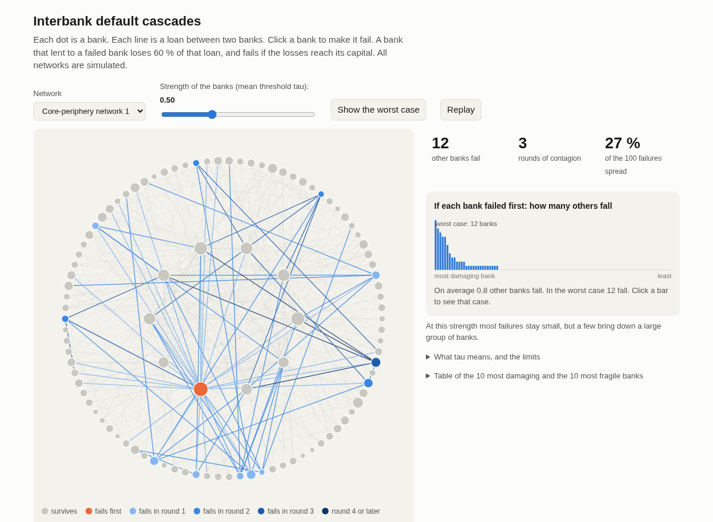
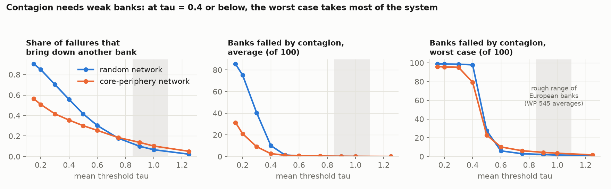
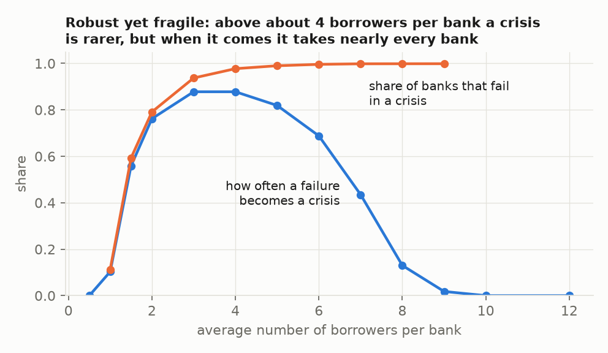
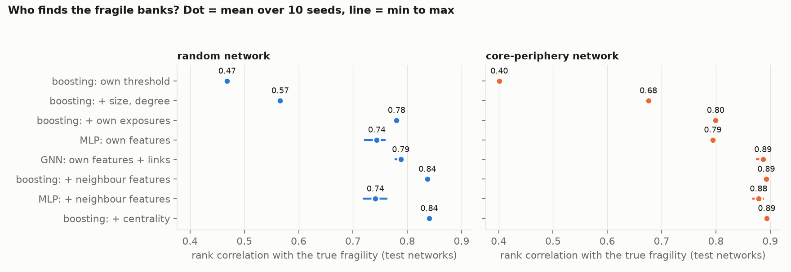
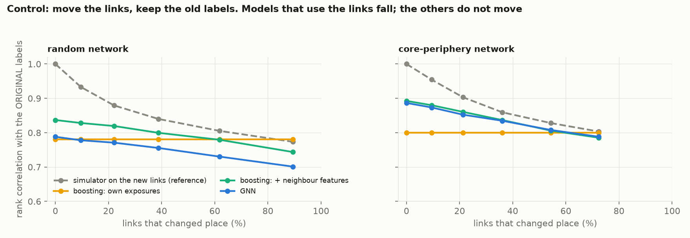

# interbank-cascades

Default cascades on simulated interbank networks, and a fair test of what a graph neural network (GNN) adds to
simple methods when the task is to find the fragile banks.

This is a small reproduction and an honest comparison. It is not a new method, and it says nothing about real banks:
real bank-to-bank exposures are confidential, so every network here is simulated.

## See it

An interactive page shows the cascades: choose a network, set how strong the banks are, click a bank to make it
fail. Open `docs/index.html` in a browser, or the hosted copy: https://balmisjutas.github.io/interbank-cascades/

The page runs the same rule in JavaScript. `node tests/viewer.test.mjs` checks that it gives the same 1,800
cascades as the Python simulator.

## The question

1. When one bank fails, in which conditions do other banks fail after it?
2. Can a model find the banks that are most at risk? Does a GNN do it better than gradient boosting on features
   that anyone can build by hand?

## The cascade rule

`E[i, j]` is what bank `i` lent to bank `j`. A bank fails when its capital is wiped out. When a bank fails, each of
its lenders loses a fixed share (the loss given default, LGD) of what it lent to it:

    C_k(i) = max( C_0(i) - LGD * sum over failed j of E[i, j], 0 )

The rounds repeat until no new bank fails. This is the sequential default algorithm of Furfine (2003), with a fixed
LGD, as written in Banque de France Working Paper 432 (eq. 2.2) and in Upper (BIS Working Paper 234). It is not the
Eisenberg-Noe clearing model. LGD is 60 %, the value of the two Banque de France papers.

With this rule, a bank fails when the failed share of its lending is above its threshold

    tau_i = capital_i / (LGD * interbank assets_i)

So capital, LGD and the size of interbank lending are one parameter, not three, and the rule has no scale
(`tests/test_sim.py` checks both). A common shock that takes a share `s` of every bank's capital, as central banks
apply before the first default, is the same as multiplying every `tau` by `1 - s`.

## Networks

100 banks and 495 links (density 5 %), lognormal amounts, two families with the same number of banks and links:

- random: every pair is equally likely;
- core-periphery: 10 core banks, densely linked; the other 90 deal mostly with the core.

Each bank draws its own threshold around a mean `tau`, so that banks differ.

## Result 1. Contagion needs weak banks

- Above `tau` = 0.75, one failure almost never brings down more than a few banks.
- At `tau` = 0.4 or below, the worst case takes most of the system (79 to 98 banks of 100).
- The core-periphery network has fewer contagious failures than the random one at low `tau`, and more at high `tau`.
- The grey band is a rough range for European banks (my arithmetic on the averages of Working Paper 545; a guide,
  not a measure). Real banks sit where a single failure does little. The learning task below is therefore run in a
  stressed regime, `tau` = 0.5. The EU large-exposure limit (one exposure at most 25 % of capital) makes the same
  point: under it, one failed counterparty cannot wipe out a bank.

Sanity check against a known result (Gai and Kapadia 2010; 1,000 banks, equal amounts, `tau` = 0.2, no recovery):

Contagion exists only in a window of connectivity (between about 1 and 9 counterparties per bank). Inside the
window, more links make a crisis rarer, but when it comes it takes nearly every bank: "robust yet fragile".

## Result 2. The GNN reads the links, but it does not beat boosting with hand-made neighbour features

Label: fragility of a bank = share of the 99 scenarios started by another bank in which it fails.
30 training networks, 15 other test networks, 10 model seeds. Score: rank correlation (Spearman) inside each test
network, mean over the test networks; the spread between test networks is 0.03 to 0.09.
Protocol and predictions were written before the runs (`PREDICTION.md`, first commit).

| Model | What it sees | Random | Core-periphery |
|---|---|---|---|
| Boosting, rung 1 | own threshold | 0.47 | 0.40 |
| Boosting, rung 2 | + size, number of counterparties | 0.57 | 0.68 |
| Boosting, rung 3 | + own exposures (concentration) | 0.78 | 0.80 |
| MLP | same as rung 3 | 0.74 | 0.79 |
| **GNN**, 2 GraphConv layers | same as rung 3, plus the links | **0.79** | **0.89** |
| Boosting, rung 4 | + sum, mean, max, min, weighted mean of the borrowers' features | **0.84** | **0.89** |
| MLP | same as rung 4 | 0.74 | 0.88 |
| Boosting, rung 5 | + eigenvector, hub and authority centrality | 0.84 | 0.89 |

- The GNN beats the MLP that has the same inputs, so it does use the links. With the links removed at test time it
  falls to the MLP level (0.75 and 0.78). With the links reversed it falls to 0.61 and 0.40.
- The GNN does not beat boosting with hand-made neighbour features: level on core-periphery networks, 0.05 behind
  on random networks. In the top 10 % of banks the picture is mixed (precision 0.74 for the GNN against 0.69 on
  random networks, 0.91 against 0.91 on core-periphery).
- Centrality adds nothing once the neighbour features are there.
- Trained on one family and tested on the other, boosting keeps its score (0.84 and 0.87). The GNN keeps it one
  way (0.84) and loses it the other way (0.65, unstable across seeds). The MLP with neighbour features fails the
  same way, so this looks like a problem of the neural models with a new range of inputs, not of the graph part.
- Second label (share of scenarios in which a bank loses more than 10 % of its capital, the definition of ACPR
  Débats économiques et financiers no. 15): same order. Rung 3: 0.70 and 0.86; rung 4: 0.83 and 0.94; GNN: 0.81
  and 0.94.

### Control: move the links, keep the old labels

Degree-preserving edge randomisation at test time: links are swapped so that every bank keeps its number of
borrowers, its number of lenders and its own amounts. Only who is linked to whom changes. The labels stay those of
the original network. The reference is the simulator itself, run on the new links.

- Models that see only the bank itself do not move, as they must.
- Boosting with neighbour features and the GNN both fall, and they fall with the reference. Scored against the
  labels of the NEW network, both keep their level (0.83 and 0.90 for boosting, 0.80 and 0.90 for the GNN). Both
  follow the links that they are given.

### Predictions against results

| Prediction (written before the runs) | Result |
|---|---|
| The GNN beats the MLP with the same inputs | Yes |
| The GNN does not beat boosting with neighbour features | Yes: level or behind |
| Centrality adds little | Yes |
| Under randomisation, own-feature models do not move; the others fall with the reference | Yes |
| On the 10 % loss label, own exposures are already close to the best score | No: neighbour information adds 0.08 to 0.13 |

## Limits

- Simulated networks. The results describe this generator, not a banking system.
- The labels come from a simulator that runs in milliseconds, so a model that imitates it has no practical use
  here. The useful case would be hidden links: supervisors do not see every exposure. Not done.
- One cascade rule: solvency only. No liquidity hoarding, no fire sales, no common shock beyond the `tau` scaling.
  The sequential rule ignores the extra losses of banks that have already failed (BIS Working Paper 455).
- A stressed regime. At realistic capital the label is almost all zeros.
- Two GNN layers see two rounds. At `tau` = 0.5, 15 % (core-periphery) and 35 % (random) of the failures happen
  after round 2. This may explain part of the gap on random networks; it was not tested.
- No tuning of any model. A tuned GNN or a deeper one could do better; so could a tuned boosting model.

## Prior work

- Furfine (2003), "Interbank exposures: quantifying the risk of contagion"; Upper (2011), BIS Working Paper 234.
- Fourel, Héam, Salakhova, Tavolaro (2013), Banque de France Working Paper 432; Gabrieli, Salakhova, Vuillemey
  (2015), Working Paper 545; Hauton and Héam (2014), ACPR Débats économiques et financiers no. 15.
- Gai and Kapadia (2010), "Contagion in financial networks".
- León, Machado, Sarmiento (2014), Banco de la República, Borradores de Economía 816: hub and authority centrality
  to find "super-spreaders" in the Colombian interbank network (the source of the hub and authority features).
- Balmaseda, Coronado, de Cadenas-Santiago (2023), "Predicting systemic risk in financial systems using Deep Graph
  Learning": GNNs beat classic models, but those models get no network feature and the split is over the nodes of
  one graph.
- Uddin (2026), arXiv 2604.14232: XGBoost is level with the GNN, and permuting the edges does not change the score.
- Hussain et al. (2021) and Fosdick et al. (2018) for the edge-randomisation control.

## Run it

    uv sync
    uv run pytest
    uv run python experiments/01_regimes.py    # about 15 seconds
    uv run python experiments/02_compare.py    # about 8 minutes on a laptop CPU
    uv run python experiments/03_figures.py
    uv run python experiments/04_export_viewer.py   # data of the interactive page
    node tests/viewer.test.mjs

`src/cascades/sim.py` is the cascade rule (about 40 lines for one cascade). `tests/test_sim.py` has four cases
solved by hand and eight properties of the rule.
